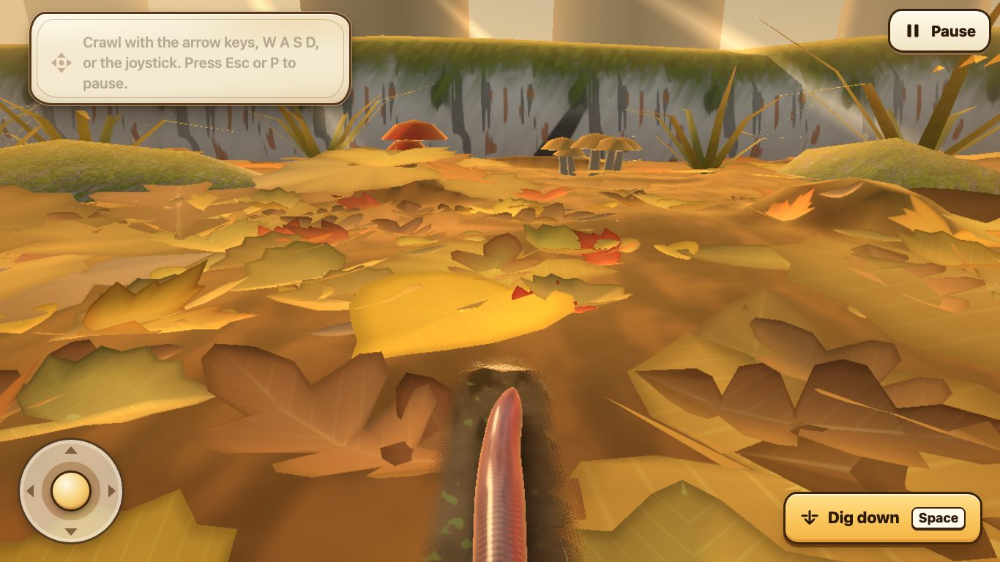
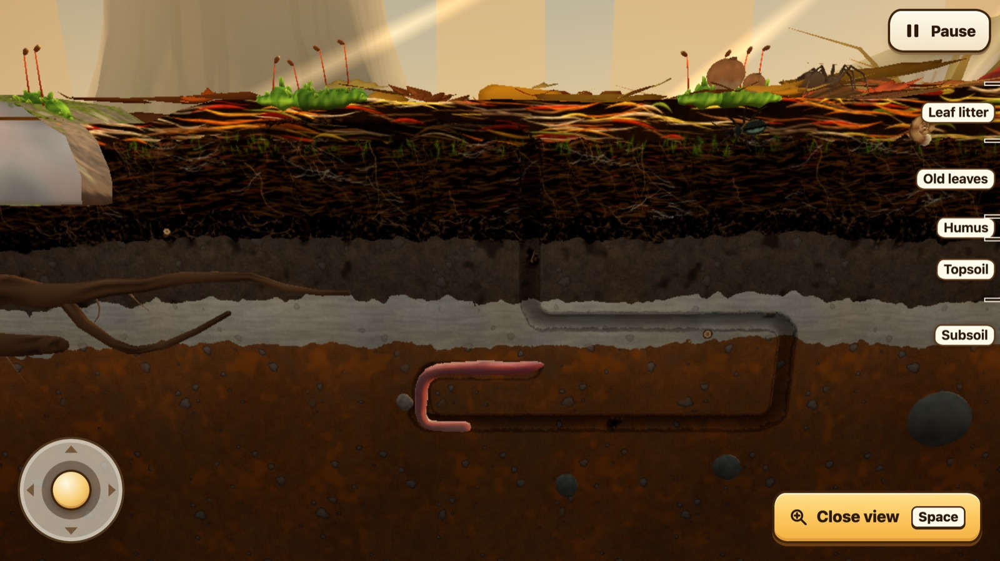

# Worm Simulator

A 3D game where you play an invasive earthworm on a Minnesota forest floor, **co-developed with
6th-grade students** one version at a time. Play it at [wormsimulator.com](https://wormsimulator.com).




## The experiment

Can students build a video game by applying what they learn in class? Here, students learn about
earthworms and how they change northern forests, then decide how that science should show up in the
game. They want the game to be realistic *and* fun, so they have a real reason to learn the
concepts well.

It works because **AI does the coding and the graphics**. Students don't need to know how to
program. Their job is to learn, design, vote and critique. The teacher edits and decides, and the
AI builds.

The goal is student **agency and engagement**: when students see their ideas in a real game,
the topic becomes theirs.

## How a round works

Each round produces a new version of the game (V1, V2, V3…), and each round is **optional homework**.

1. **Learn.** The game opens with a short interactive intro on the round's worm topic.
2. **Play with a job.** Every student gets one of three roles, rotating each round so everyone
   tries all three: *Scientist* (is it true to real worms?), *Mechanic* (do the controls work,
   where did you get stuck, could you play on your device?), or *Artist* (does it look and feel
   like being a worm on a real forest floor?).
3. **Give feedback.** A Google Form, linked from the class Canvas page, asks students to critique
   the build, vote on classmates' designs and the next topic, and (optionally) design something
   new, with evidence for why it's true of real worms.
4. **Decide.** Class periods are weighted equally. Votes are input, and the teacher makes the
   final call in public and explains why.
5. **Build and close the loop.** The AI builds the chosen design. The next round opens with
   "You said, we built", and the changelog credits ideas by class period, never by name.

## The co-development framework

Every round is guided by a general [Co-Development Framework](docs/codev/FRAMEWORK.md) for building
software with students. Its principles include learning before designing, backing designs with
evidence, treating votes as input to a named decider, and always closing the loop. How this
project applies it is in [IMPLEMENTATION.md](docs/codev/IMPLEMENTATION.md).

## Beyond worms

Nothing about this approach is specific to worms or 6th grade. Any subject where students can
learn something real and turn it into a design decision could work: ecosystems, history,
chemistry, economics, at any grade level.

## Ground rules

- **Science honesty.** Every fact in the game has a source. Exaggerations are labelled "Game choice".
- **Student privacy.** The game has no accounts, tracking or data collection. No student
  names or identifying data appear in this repo.
- **Accessibility and performance.** The game runs at 30 fps on low-end school Chromebooks and
  works with keyboard, mouse and touch.

## For developers

TypeScript and three.js, built to a single HTML file.

```bash
npm install
npm run dev    # local dev server
npm test       # unit tests
```

See [CLAUDE.md](CLAUDE.md) for project rules and [CHANGELOG.md](CHANGELOG.md) for what changed in
each version.
